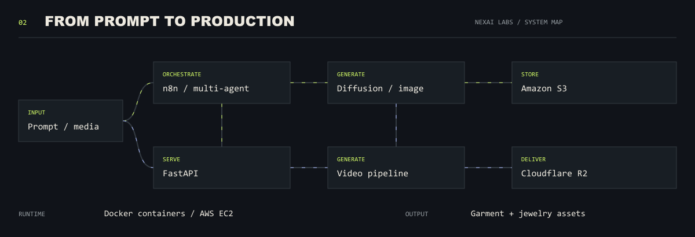
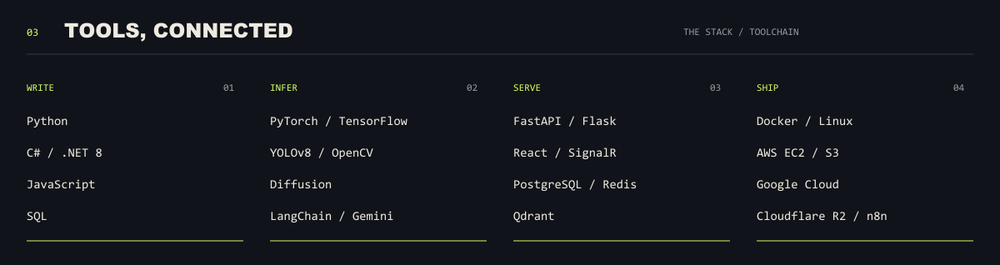
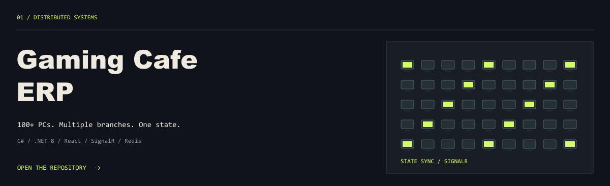
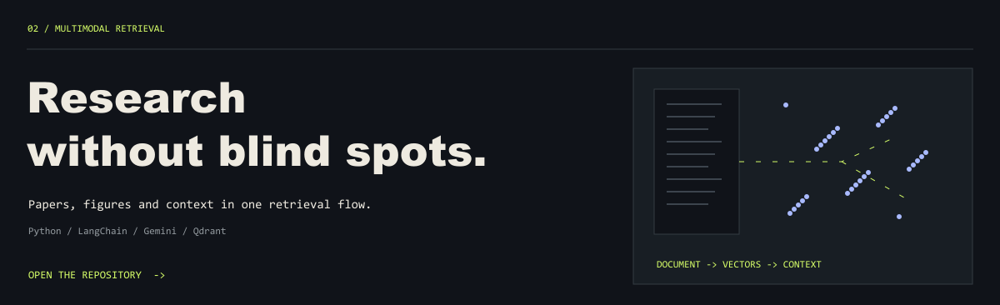
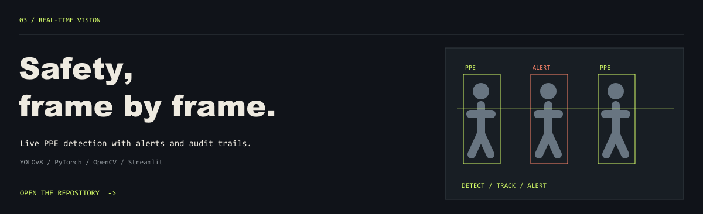

  

  <a href="mailto:harshalparekh17@gmail.com">Email</a> &nbsp; / &nbsp;
  <a href="https://linkedin.com/in/harshal-p-parekh">LinkedIn</a> &nbsp; / &nbsp;
  <a href="https://github.com/harshal4172005/harshal4172005/blob/main/Harshal_Parekh_Resume.pdf">Resume</a> &nbsp; / &nbsp;
  <a href="https://github.com/harshal4172005?tab=repositories">Explore the code</a>

Background, in plain text

I'm **Harshal Parekh**, an AI engineer and systems developer based in Surat, India. At **NexAI Labs**, I built diffusion-based image and video pipelines for commercial garment and jewelry brands, connected multi-agent n8n workflows to FastAPI services, and deployed with Docker on AWS EC2, S3 and Cloudflare R2.

- **Impact:** pipelines for 5+ commercial brands; 60% faster creative turnaround.
- **Education:** B.E. Computer Engineering, C.K. Pithawala College; CGPA **8.41 / 10**.
- **Learning:** 22 Google Cloud skill badges across Gemini, Cloud Run and Vision. Skill badges are distinct from a professional certification.
- **Looking for:** full-time AI/ML, backend and software engineering opportunities worldwide.

Experience and project impact figures are supplied by me. The activity panel below is generated from GitHub data.

### Selected builds / inspect the source

More experiments

- [Speech to sign language](https://github.com/harshal4172005/audio-speech-to-sign-language) — assistive communication with Python, NLP and speech recognition.
- [Stock data engine](https://github.com/harshal4172005/EXTRACT-REAL-TIME-DATA-OF-STOCK-S) — market data extraction and analysis.
- [E-commerce extraction](https://github.com/harshal4172005/scrapping-of-amazon-data-using-selenium) — browser automation with Python and Selenium.

Open the latest commits / how this updates

<!-- ACTIVITY:START -->
- [9f0a7c8](https://github.com/harshal4172005/harshal4172005/commit/9f0a7c8285a2be67053182d0ef62ede638690860) · `harshal4172005` · 2026-11-06
- [8394560](https://github.com/harshal4172005/harshal4172005/commit/839456075b1443b459606166f31a5b6a83e0e049) · `harshal4172005` · 2026-11-06
- [e85bdd1](https://github.com/harshal4172005/harshal4172005/commit/e85bdd1b68a8c89a79dffae5b28a140ae16792c1) · `harshal4172005` · 2026-11-06
- [562a4dc](https://github.com/harshal4172005/harshal4172005/commit/562a4dcd168a7eee0ac7171b17826bc872ced1f5) · `harshal4172005` · 2026-11-06
<!-- ACTIVITY:END -->

The landscape is built from the past year's contribution calendar. Each ridge represents a week; its height follows actual daily contribution counts. Aggregate counts may include private contributions, but private repository details are never published.

The commit feed samples your latest 12 commits per public default branch and shows the four most recent authored commits. Language share measures code bytes across public owned non-fork repositories, using each repo's top 20 languages; it isn't a skill rating. No languages are hidden to inflate a percentage.

**Refresh behavior:** pushes to this profile trigger a rebuild. Activity in other public repositories is checked at minutes 17 and 47 each hour; GitHub may delay scheduled runs and cache refreshed images. Branch commits appear in the feed when they reach a default branch. Manual refresh: [Living engineering profile](https://github.com/harshal4172005/harshal4172005/actions/workflows/update-stats.yml). A `repository_dispatch` event of type `profile-activity` can also trigger a refresh.

[Generator](scripts/generate_stats.py) · [Data snapshot](data/activity.json) · [Illustration source](scripts/design.py)

