


<a href="mailto:harshalparekh17@gmail.com">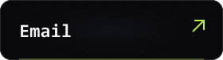</a>

<a href="https://linkedin.com/in/harshal-p-parekh">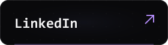</a>

<a href="https://github.com/harshal4172005/harshal4172005/blob/main/Harshal_Parekh_Resume.pdf">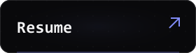</a>

<a href="https://github.com/harshal4172005?tab=repositories">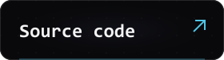</a>

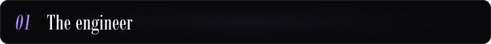

### AI engineer · Vision systems · Production diffusion

I'm **Harshal Parekh**, based in Surat, India. At **NexAI Labs**, I built diffusion-based image and video pipelines for garment and jewelry brands, connected n8n workflows to FastAPI services, and deployed them with Docker on AWS.

- **Impact:** pipelines for **5+ brands**, with **60% faster** creative turnaround.
- **Education:** B.E. Computer Engineering, C.K. Pithawala College — **CGPA 8.41 / 10**.
- **Learning:** **22 Google Cloud skill badges** across Gemini, Cloud Run and Vision.
- **Open to:** full-time **AI/ML, backend and software engineering** roles worldwide.

<picture>
<source media="(max-width: 600px)" srcset="https://raw.githubusercontent.com/harshal4172005/harshal4172005/main/assets/readable-ascent-mobile.svg?v=readable1" />
</picture>

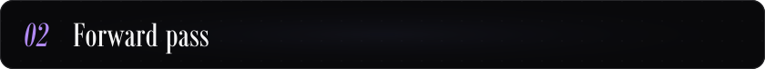

- **Languages:** Python, C#, JavaScript, SQL.
- **AI / vision:** PyTorch, TensorFlow, YOLOv8, OpenCV, diffusion, LangChain, Gemini.
- **Backend / data:** FastAPI, Flask, .NET 8, React, SignalR, Redis, PostgreSQL, Qdrant.
- **Infrastructure:** Docker, Linux, AWS, Google Cloud, Cloudflare R2, n8n.


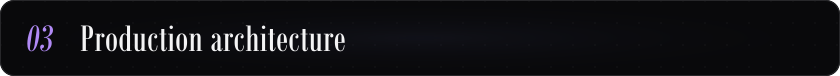

**Flow:** prompt / media → n8n orchestration → diffusion or video generation → Amazon S3 / Cloudflare R2.

**Runtime:** FastAPI services in Docker on AWS EC2, delivering assets for garment and jewelry brands.


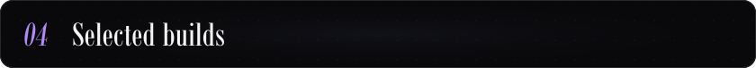

### [Gaming Cafe ERP](https://github.com/harshal4172005/APPLE-ESPORTS-GAMMING-SOFTWARE)

Multi-branch management for **100+ PCs**, with live SignalR synchronization and remote workstation lock / unlock.

**Stack:** C# · .NET 8 · React · SignalR · Redis · Docker

<a href="https://github.com/harshal4172005/APPLE-ESPORTS-GAMMING-SOFTWARE"><picture>
<source media="(max-width: 600px)" srcset="https://raw.githubusercontent.com/harshal4172005/harshal4172005/main/assets/readable-project-erp-mobile.svg?v=readable1" />
</picture></a>

### [Multimodal Research RAG](https://github.com/harshal4172005/multimodal-ai-research-rag)

Research-paper QA that reads the figures: Gemini Vision captions, Qdrant retrieval, and Groq / NVIDIA fallback.

**Stack:** Python · LangChain · FastAPI · Gemini · Qdrant

<a href="https://github.com/harshal4172005/multimodal-ai-research-rag"><picture>
<source media="(max-width: 600px)" srcset="https://raw.githubusercontent.com/harshal4172005/harshal4172005/main/assets/readable-project-rag-mobile.svg?v=readable1" />
</picture></a>

### [AI CCTV Safety](https://github.com/harshal4172005/AI-CCTV-SURVEILLANCE-)

Live WebRTC PPE detection for hard hats, vests and masks, with alerts and audit logging.

**Stack:** YOLOv8 · PyTorch · OpenCV · Streamlit

<a href="https://github.com/harshal4172005/AI-CCTV-SURVEILLANCE-"><picture>
<source media="(max-width: 600px)" srcset="https://raw.githubusercontent.com/harshal4172005/harshal4172005/main/assets/readable-project-cctv-mobile.svg?v=readable1" />
</picture></a>

More experiments

- [Speech to sign language](https://github.com/harshal4172005/audio-speech-to-sign-language) — assistive communication with Python, NLP and speech recognition.
- [Stock data engine](https://github.com/harshal4172005/EXTRACT-REAL-TIME-DATA-OF-STOCK-S) — market data extraction and analysis.
- [E-commerce extraction](https://github.com/harshal4172005/scrapping-of-amazon-data-using-selenium) — browser automation with Python and Selenium.

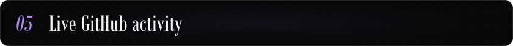

<!-- METRICS:START -->
**Total contributions: 1,061** — 532 public + 529 private.

**Today:** 30 contributions · **Current streak:** 3 days · **Longest streak:** 15 days in the past year.
<!-- METRICS:END -->

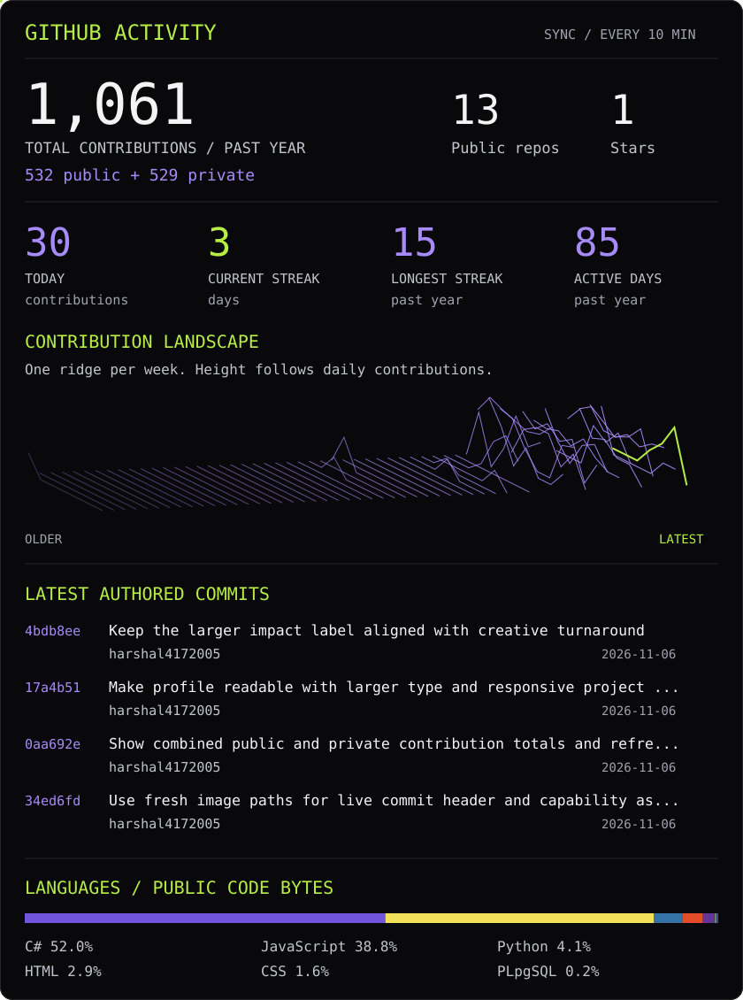

Open the latest commits / how this updates

<!-- ACTIVITY:START -->
- [17a4b51](https://github.com/harshal4172005/harshal4172005/commit/17a4b513ecd17036074978474f97d0cd98090ec3) · `harshal4172005` · 2026-11-06
- [0aa692e](https://github.com/harshal4172005/harshal4172005/commit/0aa692edeb54a01f7368a19e0027b5e3d3c034c1) · `harshal4172005` · 2026-11-06
- [34ed6fd](https://github.com/harshal4172005/harshal4172005/commit/34ed6fdd9ca24b3ca0b6becb6052f40cbd170907) · `harshal4172005` · 2026-11-06
- [647bfb7](https://github.com/harshal4172005/harshal4172005/commit/647bfb79e8bda822a73c6f21b6b7b92564fd252a) · `harshal4172005` · 2026-11-06
<!-- ACTIVITY:END -->

The landscape is built from the past year's contribution calendar. Each ridge represents a week; its height follows actual daily contribution counts. Counts include public and shared private activity; private repository details are never published.

The commit feed samples your latest 12 commits per public default branch and shows the four most recent authored commits. Language share measures code bytes across public owned non-fork repositories, using each repo's top 20 languages; it isn't a skill rating. No languages are hidden to inflate a percentage.

**Daily streaks:** today's contributions, current streak, longest streak in the past year, and active days are recalculated on each refresh. Streaks use GitHub calendar dates (UTC). If you contributed yesterday, your current streak stays alive while today is still open; a missed day resets it. Only contributions included by GitHub's API count, so an unmerged feature-branch commit may not appear yet.

**Total contributions:** the header and dashboard show the same combined public + private total from GitHub's past-year contribution calendar. Private contributions are included as anonymized counts while GitHub's **Contribution settings → Private contributions** option is enabled. This is fetched automatically, not fixed to a manually entered number. The dashboard also shows the public/private breakdown.

**Refresh behavior:** pushes to this profile trigger a rebuild. Contribution activity is checked every 10 minutes; GitHub may delay scheduled runs and cache refreshed images. Branch commits appear in the feed when they reach a default branch. Manual refresh: [Living engineering profile](https://github.com/harshal4172005/harshal4172005/actions/workflows/update-stats.yml). A `repository_dispatch` event of type `profile-activity` can also trigger a refresh.

[Generator](scripts/generate_stats.py) · [Data snapshot](data/activity.json) · [Illustration source](scripts/design.py)

<a href="mailto:harshalparekh17@gmail.com"></a>
