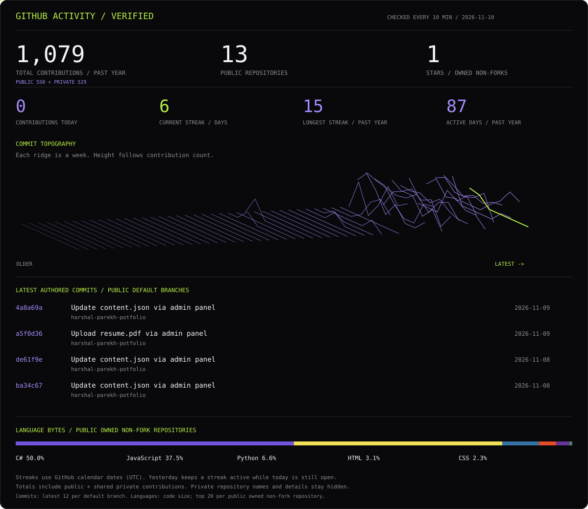

Background, in plain text

I'm **Harshal Parekh**, an AI engineer and systems developer based in Surat, India. At **NexAI Labs**, I built diffusion-based image and video pipelines for commercial garment and jewelry brands, connected multi-agent n8n workflows to FastAPI services, and deployed with Docker on AWS EC2, S3 and Cloudflare R2.

- **Impact:** pipelines for 5+ commercial brands; 60% faster creative turnaround.
- **Education:** B.E. Computer Engineering, C.K. Pithawala College; CGPA **8.41 / 10**.
- **Learning:** 22 Google Cloud skill badges across Gemini, Cloud Run and Vision. Skill badges are distinct from a professional certification.
- **Looking for:** full-time AI/ML, backend and software engineering opportunities worldwide.

Experience and project impact figures are supplied by me. The activity panel below is generated from GitHub data.

Project links and descriptions

- [Gaming Cafe ERP](https://github.com/harshal4172005/APPLE-ESPORTS-GAMMING-SOFTWARE) — 100+ PCs across branches, live SignalR synchronization and remote workstation lock/unlock.
- [Prism — Paper Learning Studio](https://github.com/harshal4172005/multimodal-ai-research-rag) — multimodal PDF explanations, original-page sources, multi-paper conversations, saved chats, an editable notebook and five numerical learning labs. Built with FastAPI, Gemini, SQLite FTS5/BM25 and JavaScript. [Open the app](https://prism.140.245.195.222.sslip.io/).
- [AI CCTV Safety](https://github.com/harshal4172005/AI-CCTV-SURVEILLANCE-) — live WebRTC PPE detection with alerts and audit logs. Worker motion, boxes and confidence values are illustrative.

The animations illustrate system behavior. They are not live camera feeds, model confidence measurements or production telemetry.

More experiments

- [Speech to sign language](https://github.com/harshal4172005/audio-speech-to-sign-language) — assistive communication with Python, NLP and speech recognition.
- [Stock data engine](https://github.com/harshal4172005/EXTRACT-REAL-TIME-DATA-OF-STOCK-S) — market data extraction and analysis.
- [E-commerce extraction](https://github.com/harshal4172005/scrapping-of-amazon-data-using-selenium) — browser automation with Python and Selenium.

Open the latest commits / how this updates

<!-- ACTIVITY:START -->
- [4a8a69a](https://github.com/harshal4172005/harshal-parekh-potfolio/commit/4a8a69aa16a50743255532f9abb9bc74e9808c1e) · `harshal-parekh-potfolio` · 2026-11-09
- [a5f0d36](https://github.com/harshal4172005/harshal-parekh-potfolio/commit/a5f0d364a0755d318227ae012ab3e9e508a36bac) · `harshal-parekh-potfolio` · 2026-11-09
- [de61f9e](https://github.com/harshal4172005/harshal-parekh-potfolio/commit/de61f9e000073d6c3830fcae1b0e106baf97073d) · `harshal-parekh-potfolio` · 2026-11-08
- [ba34c67](https://github.com/harshal4172005/harshal-parekh-potfolio/commit/ba34c677458112bb1852c2e8e2885378aaade2db) · `harshal-parekh-potfolio` · 2026-11-08
<!-- ACTIVITY:END -->

The landscape is built from the past year's contribution calendar. Each ridge represents a week; its height follows actual daily contribution counts. Counts include public and shared private activity; private repository details are never published.

The commit feed samples your latest 12 commits per public default branch and shows the four most recent authored commits. Language share measures code bytes across public owned non-fork repositories, using each repo's top 20 languages; it isn't a skill rating. No languages are hidden to inflate a percentage.

**Daily streaks:** today's contributions, current streak, longest streak in the past year, and active days are recalculated on each refresh. Streaks use GitHub calendar dates (UTC). If you contributed yesterday, your current streak stays alive while today is still open; a missed day resets it. Only contributions included by GitHub's API count, so an unmerged feature-branch commit may not appear yet.

**Total contributions:** the header and dashboard show the same combined public + private total from GitHub's past-year contribution calendar. Private contributions are included as anonymized counts while GitHub's **Contribution settings → Private contributions** option is enabled. This is fetched automatically, not fixed to a manually entered number. The dashboard also shows the public/private breakdown.

**Refresh behavior:** pushes to this profile trigger a rebuild. Contribution activity is checked every 10 minutes; GitHub may delay scheduled runs and cache refreshed images. Branch commits appear in the feed when they reach a default branch. Manual refresh: [Living engineering profile](https://github.com/harshal4172005/harshal4172005/actions/workflows/update-stats.yml). A `repository_dispatch` event of type `profile-activity` can also trigger a refresh.

[Generator](scripts/generate_stats.py) · [Data snapshot](data/activity.json) · [Illustration source](scripts/design.py)

