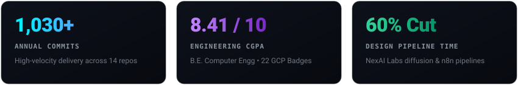

 

  

---

### Experience &amp; Engineering Focus

**Junior AI Engineer &bull; NexAI Labs** *(Nov 2025 &ndash; Apr 2026)*
* Engineered diffusion-model image and video generation pipelines for 5+ commercial brands, cutting manual design effort by 60%.
* Automated multi-agent workflows end-to-end with n8n, unifying disparate model APIs for seamless client delivery.
* Deployed AI microservices as FastAPI/Flask REST endpoints on AWS EC2 with storage on S3 and Cloudflare R2.

**Academic &amp; Professional Background**
* **B.E. in Computer Engineering** &mdash; C.K. Pithawala College of Engineering &amp; Technology (CGPA: **8.41 / 10**).
* **Google Cloud Certified** with 22 verified Skill Badges across Generative AI, Cloud Run, and Vision API.
* Based in Surat, India &bull; Open to relocation &bull; Available to join immediately.

---

### Core Tech Stack

**AI &bull; Machine Learning &bull; Computer Vision**

 

**Cloud &bull; Databases &bull; Systems**

---

### Selected Engineering Projects

| Project | Core Stack | Architecture &amp; Delivery |
|:---|:---|:---|
| **[Multimodal RAG Research Assistant](https://github.com/harshal4172005/multimodal-ai-research-rag)** | `Python` `LangChain` `Qdrant` `Gemini` | Research paper query engine with Gemini Vision diagram captioning, Qdrant vector search, and a Groq/NVIDIA NIM fallback retry chain. |
| **[AI CCTV Safety Surveillance](https://github.com/harshal4172005/AI-CCTV-SURVEILLANCE-)** | `Python` `YOLOv8` `PyTorch` `WebRTC` | Real-time PPE safety violation detector fine-tuned on a 10-class dataset with instant violation cropping and Streamlit analytics. |
| **[Audio Speech-to-Sign Language](https://github.com/harshal4172005/audio-speech-to-sign-language)** | `Python` `NLP` `SpeechRecognition` | Real-time assistive application translating continuous verbal audio into visual sign language representation. |
| **[Real-Time Stock Analytics Engine](https://github.com/harshal4172005/EXTRACT-REAL-TIME-DATA-OF-STOCK-S)** | `Python` `Google Finance` `ETL` | High-throughput streaming data pipeline extracting and organizing real-time financial market metrics. |
| **[Large-Scale Amazon Web Scraper](https://github.com/harshal4172005/scrapping-of-amazon-data-using-selenium)** | `Python` `Selenium` `Automation` | Production scraping engine built with anti-bot handling and resilient dynamic page extraction. |
| **[Multi-Branch Gaming Cafe ERP](https://github.com/harshal4172005/APPLE-ESPORTS-GAMMING-SOFTWARE)** | `React` `Docker` `SignalR` `Redis` | Multi-branch cafe management platform orchestrating live PC lock/unlock control and automated session billing. |

---

HARSHAL PAREKH &nbsp;//&nbsp; AI &amp; PYTHON SYSTEMS &nbsp;//&nbsp; 2026

